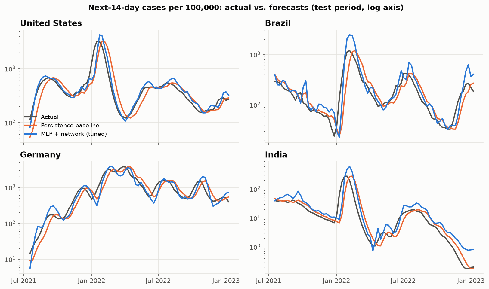
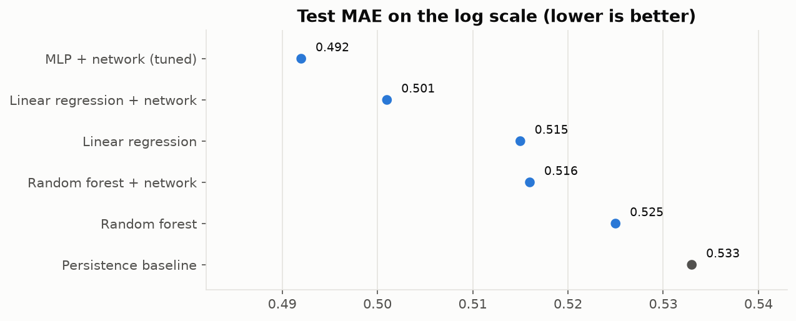
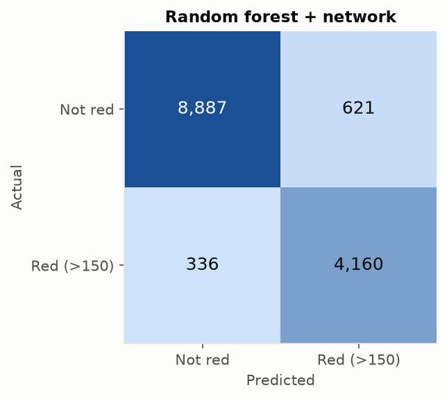
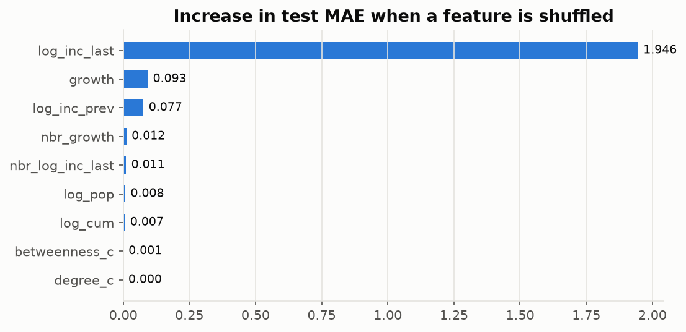
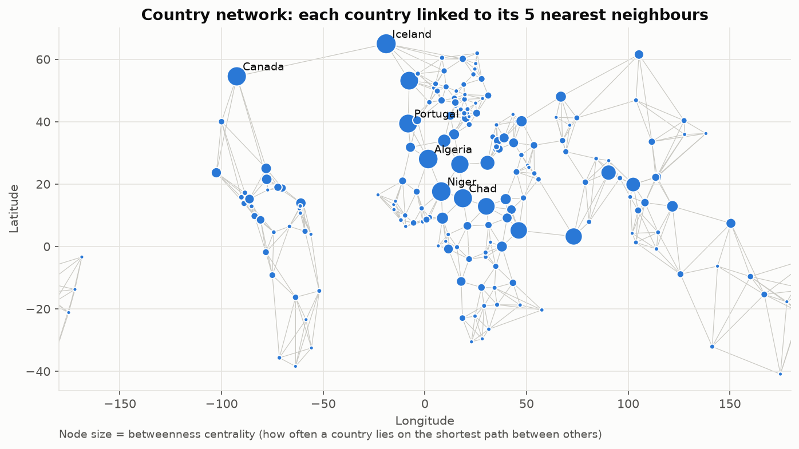
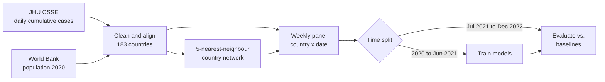

<div align="center">

# 🦠 SafeConnect | Disease Spread Forecasting with Real-World Data

**Forecasting COVID-19 incidence for 183 countries with time-based validation, honest baselines and a country network**


[](https://colab.research.google.com/github/Laurentius96/SafeConnect-Health-Prevention-Platform/blob/main/safeconnect_analysis.ipynb)

<p>
  <a href="#-overview">Overview</a> •
  <a href="#-results">Results</a> •
  <a href="#-network-science">Network</a> •
  <a href="#-method">Method</a> •
  <a href="#-what-changed-from-the-original-pitch">What Changed</a> •
  <a href="#-how-to-run">How to Run</a> •
  <a href="#-license">License</a>
</p>

</div>

---

## 🔍 Overview

Health authorities plan testing, hospital capacity and travel rules weeks ahead. **SafeConnect asks whether a country's reported COVID-19 incidence over the next 14 days can be forecast from what is known today, and whether what is happening in neighbouring countries helps.**

The analysis uses only public data: daily confirmed cases from **JHU CSSE** (Jan 2020 to Mar 2023) and population from the **World Bank**. Every country and week becomes one observation; models are trained on 2020 to mid-2021 and tested on mid-2021 to the end of 2022, a future they never saw, including the Delta and Omicron waves.

| | |
|---|---|
| 🌍 Countries | 183 (after aligning JHU and World Bank names) |
| 🗓️ Observations | 24,838 country-weeks: 10,482 train, 14,004 test |
| 📉 Best forecast | MLP with network features: **7.7% lower error** than the persistence baseline, R² 0.897 |
| 🚦 Red-zone alert | Random forest with network features: **balanced accuracy 0.930**, ROC AUC 0.978 |
| 🕸 Network | 5-nearest-neighbour geographic graph; neighbours' incidence improves the linear and random-forest forecasts |

<p align="center">
  
</p>

## 📊 Results

All metrics are on the **test period** (July 2021 to December 2022).

### Forecasting the next 14 days (regression)

Target: log(1 + cases per 100,000 in the next 14 days). The **persistence baseline** assumes the next 14 days repeat the last 14.

| Model | MAE | RMSE | R² |
|---|---:|---:|---:|
| Persistence baseline | 0.533 | 0.848 | 0.878 |
| Linear regression | 0.515 | 0.846 | 0.878 |
| Linear regression + network | 0.501 | 0.821 | 0.885 |
| Random forest | 0.525 | 0.818 | 0.886 |
| Random forest + network | 0.516 | 0.806 | 0.889 |
| **MLP + network** (tuned with time-series CV) | **0.492** | **0.776** | **0.897** |

<p align="center">
  
</p>

### Red-zone alert (classification)

A country is **red** when it reports **more than 150 cases per 100,000 in the next 14 days**, the level above which the EU travel-coordination map ([Council Recommendation (EU) 2020/1475](https://eur-lex.europa.eu/eli/reco/2020/1475/2021-02-02/eng)) classified a region as red regardless of test positivity. Red rows: 22.9% of training, 32.1% of test.

| Model | Balanced accuracy | Precision | Recall | F1 | ROC AUC |
|---|---:|---:|---:|---:|---:|
| Persistence baseline (already red today) | 0.907 | 0.871 | 0.874 | 0.873 | – |
| Perceptron | 0.909 | 0.761 | 0.961 | 0.849 | 0.968 |
| Adaline (SGD, squared loss) | 0.881 | 0.680 | 0.981 | 0.803 | 0.970 |
| Logistic regression | 0.925 | 0.820 | 0.949 | 0.880 | 0.973 |
| Logistic regression + network | 0.928 | 0.825 | 0.952 | 0.884 | 0.973 |
| Random forest | 0.928 | 0.863 | 0.925 | 0.893 | 0.977 |
| **Random forest + network** | **0.930** | 0.870 | 0.925 | **0.897** | **0.978** |
| MLP + network | 0.912 | **0.904** | 0.867 | 0.885 | 0.972 |

<details>
<summary><b>Confusion matrix of the best classifier</b></summary>
<br>
<p align="center">
  
</p>
</details>

### Early warning: will incidence rise by 20% or more?

A harder question. On rows with at least 10 cases per 100,000, logistic regression reaches a **balanced accuracy of 0.722** against 0.709 for simple momentum ("it rises if it rose last time"), with ROC AUC 0.776. Network features do not help here.

## 💡 Key Findings

| Topic | Finding |
|---|---|
| 📏 Baselines matter | Persistence alone reaches R² 0.878: incidence changes slowly compared with the gap between countries, so any model must be judged against it |
| 🏆 Best forecast | The tuned MLP with network features cuts the MAE by 7.7% (0.533 → 0.492) |
| 🕸 Neighbours help | Network features improve the linear model (0.515 → 0.501) and the random forest (0.525 → 0.516); in permutation importance, the neighbours' growth and incidence rank right after the country's own history |
| 📍 Position does not | Degree and betweenness centrality add almost nothing: what matters is what the neighbours are going through, not where a country sits in the graph |
| 🌊 Trees cannot extrapolate | Incidence above 1,000 per 100k was 1.3% of training rows and 8.3% of test rows. Above the training maximum, the random forest's MAE (1.61) is about three times that of the linear (0.52) and MLP (0.58) models |
| 🚦 Alerts | For the red zone, the Perceptron and Adaline catch almost every red case (recall 0.96 to 0.98) at the cost of more false alarms; the random forest balances both |

<details>
<summary><b>Permutation importance (random forest + network, test set)</b></summary>
<br>
<p align="center">
  
</p>
</details>

## 🌐 Network Science

Travel and trade flows per country and week are not public, so the network uses **geography as a proxy**: each country is linked to its **5 nearest countries** by great-circle distance between the JHU coordinates. The result has **184 nodes, 582 edges and one connected component**, with degrees from 5 to 10 (North Korea is in the graph but never reported 100 cases, so it has no rows in the panel). Edges crossing the date line are drawn at the map edges.

The countries that most often lie on the shortest path between others (highest **betweenness**) are bridges between regions: **Iceland** (linking Canada to Northern Europe), **Algeria, Niger and Chad** (North and Sub-Saharan Africa), **Canada** (North America and Iceland) and **Portugal** (Europe and North Africa).

<p align="center">
  
</p>

Each country receives two network features every week: the **average incidence** and the **average growth** of its neighbours, plus its **degree** and **betweenness** centrality.

## 🧭 Method



| Step | Detail |
|---|---|
| Cleaning | National rows only when they exist (no overseas territories); provinces summed for Australia, Canada and China; Hong Kong and Macau as separate economies; running maximum to absorb downward corrections |
| Name alignment | 27 JHU names mapped to World Bank names (for example `US`, `Russia`, `Iran`, `Korea, South`) |
| Exclusions | No World Bank population: cruise ships, Olympic Games, Antarctica, Holy See, Taiwan, Nauru. Under 100,000 inhabitants: 11 micro-states |
| Features | Own incidence in the last 14 days and the 14 before, growth, cumulative cases per 100k, population, neighbours' incidence and growth, centrality |
| Target | log(1 + cases per 100k in the next 14 days); red zone = more than 150; rising = at least 20% above the last 14 days |
| Validation | Time-based split with a gap so no training target overlaps the test period; MLP hyperparameters chosen with `TimeSeriesSplit` inside the training period |

## 🔄 What Changed from the Original Pitch

SafeConnect started as a postgraduate pitch. Re-reading it critically showed that its headline results could not be trusted, so the analysis was rebuilt. The original notebook (in Portuguese) is kept in [`archive/`](archive/) for transparency.

| Original pitch | Problem | This version |
|---|---|---|
| "High risk" = new cases on the last date ≥ the median | The median was 0, so all 171 countries were labelled high risk and the reported 100% accuracy was guaranteed | A fixed public-health threshold (> 150 per 100k in 14 days), 23% to 32% positives, compared with a persistence rule |
| Target: new cases on a single day (9 March 2023) | One noisy day (many countries reported weekly) and only 171 rows | 14-day windows over 143 weekly dates: 24,838 rows |
| MSE 6.56 with no reference | Without a baseline the number says nothing | Persistence baseline; MAE, RMSE and R² on an unseen future |
| Random 80/20 split of one day's countries | No test of forecasting ability | Time-based split: train 2020 to June 2021, test July 2021 to December 2022 |
| Complete graph (every country linked to every other) | Every country had the same centrality, and it was added after the models were trained | Geographic nearest-neighbour graph; neighbour features used in the models and tested with and without |
| Names matched literally between JHU and the World Bank | The US, Russia, Iran, South Korea and others were silently dropped | 27 names mapped; every exclusion listed |

## 🚀 How to Run

**Option 1: Google Colab (no installation).** Click the **Open in Colab** badge above and run all cells; the data is downloaded from the original sources automatically.

**Option 2: locally.**

```bash
git clone https://github.com/Laurentius96/SafeConnect-Health-Prevention-Platform.git
cd SafeConnect-Health-Prevention-Platform
pip install -r requirements.txt
jupyter notebook safeconnect_analysis.ipynb
```

The data snapshots in `data/` are used when present, so the results above are reproducible offline. A full run takes about a minute on a laptop and regenerates every chart in `assets/`.

## 🚧 Limitations

- **Reported cases depend on testing.** From 2022 many countries reduced testing and reporting, so the target measures reported, not true, infections.
- **Geography is a proxy** for travel and trade links, which are not public per country and week.
- Population is fixed at 2020; vaccination, variants and public-health measures are not modelled.
- The models describe association, not causation, and are a portfolio study, not a tool for real public-health decisions.

## 📁 Project Structure

```
📁 SafeConnect-Health-Prevention-Platform/
├── 📓 safeconnect_analysis.ipynb                  # Full analysis (English, executed)
├── 📁 data/
│   ├── 📄 time_series_covid19_confirmed_global.csv  # JHU CSSE snapshot (final release, Mar 2023)
│   └── 📄 world_bank_population.csv                 # World Bank SP.POP.TOTL, 2019 to 2021
├── 📁 assets/                                     # Charts generated by the notebook
├── 📁 archive/
│   └── 📓 PosDS_Pitch_Código.ipynb                # Original postgraduate pitch (Portuguese)
├── 📄 requirements.txt
├── 📄 LICENSE.md                                  # CC BY-NC-ND 4.0
└── 📄 README.md
```

## 📚 Data Sources

| Data | Source | License |
|---|---|---|
| COVID-19 confirmed cases | [JHU CSSE COVID-19 Data Repository](https://github.com/CSSEGISandData/COVID-19) (archived in March 2023) | CC BY 4.0 |
| Population, total (`SP.POP.TOTL`) | [World Bank Open Data](https://data.worldbank.org/indicator/SP.POP.TOTL) | CC BY 4.0 |

## 🤝 Contributing

Contributions, ideas and feedback are welcome!

- 🐛 **Found a bug or something unclear?** [Open an issue](https://github.com/Laurentius96/SafeConnect-Health-Prevention-Platform/issues/new) describing what happened and how to reproduce it.
- 💡 **Have an idea or a question?** [Open an issue](https://github.com/Laurentius96/SafeConnect-Health-Prevention-Platform/issues/new) and tell me about it.
- 🔧 **Want to propose a fix?** Fork the repository, create a branch (`git checkout -b fix/short-description`), commit your changes and open a pull request explaining what changed and why.

By contributing, you agree that your contribution is shared under the same license as this project.

## 📜 License

The analysis and code are licensed under the [Creative Commons Attribution-NonCommercial-NoDerivatives 4.0 International License (CC BY-NC-ND 4.0)](LICENSE.md). The data in `data/` belongs to its sources and keeps their CC BY 4.0 licenses.

**What this means:**
- ✅ You may **share** this work with **attribution**
- ❌ You may **not** use it for **commercial purposes**
- ❌ You may **not** distribute **modified versions**

## 🙏 Acknowledgments

Developed for **Module 03** of the Data Science postgraduate program at **UNIAMÉRICA**, which covers regression and prediction, deep learning, network science, the Perceptron and Adaline.

---

<div align="center">

**Lorenzo C. Bianchi** · [GitHub](https://github.com/Laurentius96) · [LinkedIn](https://www.linkedin.com/in/cb-lorenzo/)

</div>
